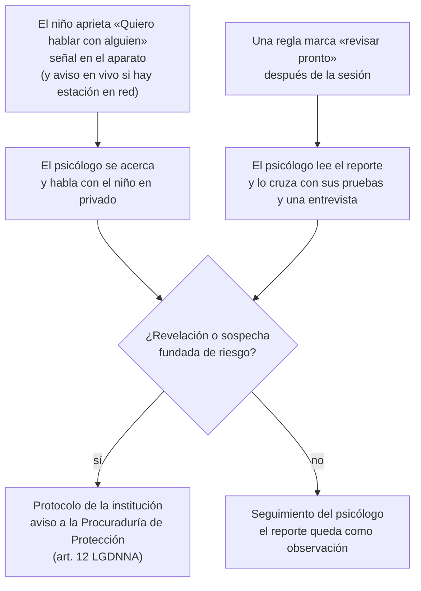

# Protocolo de aviso

Toda señal del juego llega a un psicólogo, y él decide. El juego nunca acusa ni avisa por su cuenta a familias o autoridades.

## Reglas

- Una marca del juego, sola, no es una revelación: es un motivo para evaluar.
- Si el niño cuenta algo directamente, la ley obliga a avisar (art. 12 LGDNNA, que obliga a toda persona). El psicólogo sigue el protocolo de la institución sin esperar el reporte.
- Si un niño se altera, el psicólogo pausa el juego (en el aparato o desde la consola, si hay estación) y el juego pasa al aterrizaje.
- El juego nunca le muestra al niño que hubo un aviso, salvo la pantalla del botón que él apretó: "Ya le avisamos a [nombre]. Puedes seguir jugando o esperar aquí."
- Cada aviso y lo que se hizo queda en la bitácora del programa del psicólogo, visible solo para psicólogos.

## "Quiero hablar con alguien" sin red

El botón funciona aunque no haya ninguna red. El aparato muestra una señal discreta en una esquina que el adulto presente reconoce, y el aviso queda guardado con su hora. Si hay estación en red (modo opcional), el aviso además llega en vivo a la consola.

## Lo que define cada institución

Quién avisa a la Procuraduría, en cuánto tiempo, con qué formato, y cómo se acompaña al niño mientras tanto. Ver `docs/PENDIENTES.md`.
